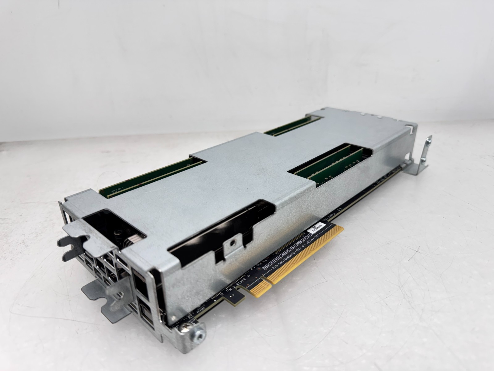
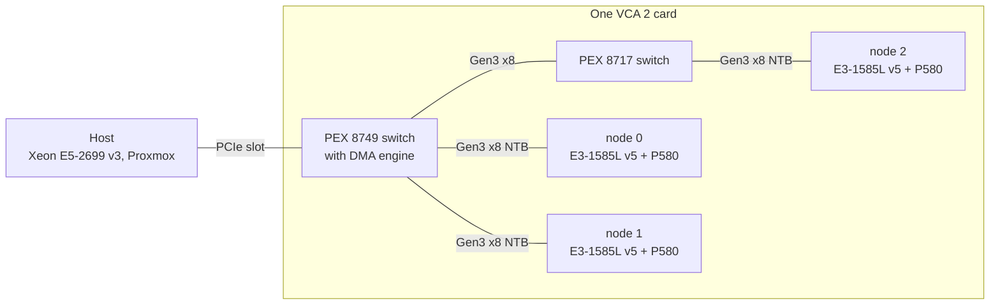

<!-- SPDX-License-Identifier: CC-BY-4.0 -->
# Intel VCA 2: making an end-of-life accelerator useful again

  

The Intel Visual Compute Accelerator 2 (VCA1585LMV) is **three complete Xeon
computers and three Iris Pro GPUs on one PCIe card**. It was built for
datacentre video transcoding, discontinued, and is now sold as e-waste. Intel
ended support years ago and there is essentially no current public
documentation for running one.

This repository is the record of bringing two of these cards back into
service on a modern Linux host, from first boot to production workloads. It
contains:

- **A measured characterisation** of the hardware: compute, the PCIe fabric,
  the on-card DMA engine, power and thermals. Every number was measured on
  real hardware between 2026-09-20 and 2026-10-09, and checked by content
  rather than just timed.
- **Working code**: kernel modules, a tuned OpenCL GEMM, a reproducible
  Ubuntu 22.04 image builder for the nodes, a boot service, a benchmark
  harness, and printable fan shrouds.
- **Three applications built on top**: a local long-term memory service for
  AI agents that runs every model stage on the card, a video render farm, and
  a hardware monitor.
- **An honest log** of what went wrong, including the claims that turned out
  to be false and the node that was lost to heat.

> [!WARNING]
> **Read [`SAFETY.md`](SAFETY.md) before running anything.** Several files
> under `plx87xx` that look read-only (mode `0444`) perform DMA or inject an
> interrupt when you `cat` them, and a routine directory walk is enough to
> oops the host. Nothing here writes firmware or EEPROM. But the card is
> passively cooled, and **one node on these cards has been lost to heat under
> sustained load**.

## What the hardware is

| | Per card |
|---|---|
| CPUs | 3 × Intel Xeon E3-1585L v5: 4C/8T Skylake, AVX2, ~16 GB DDR4 each |
| GPUs | 3 × Iris Pro P580 (GT4e): 72 EUs, 128 MB eDRAM, OpenCL + Quick Sync |
| Fabric | each node on Gen3 x8 into a PEX 8749 switch (node 2 one hop further, behind a PEX 8717), non-transparent bridges to the host |
| Host link | one PCIe Gen3 slot (x16 electrical; card 0 negotiates x8 in this host) |
| Cooling | passive heatsinks, designed for server-chassis airflow |

The three nodes are **separate computers**. Each runs its own Linux with its
own BIOS and DRAM, and reaches the host over a non-transparent PCIe bridge.
There is no coherent shared memory and no node-to-node link.

This setup has **two cards: six nodes, five of them alive**. Nodes are
numbered 0–5 throughout the docs: node *n* is card *n*÷3, CPU *n* mod 3, at
`172.31.(n+1).1`.

## Key findings

Each finding links to the document with the method, the raw numbers and the
caveats.

### 1. The GPUs reach 1.36 TFLOP/s, and the "known limits" were bugs

| | |
|---|---:|
| SGEMM, one P580, tuned kernel | **457 GFLOP/s** |
| SGEMM, all three P580s | **1359 GFLOP/s** (34% of FP32 peak) |
| Shipped kernel, all three | ~200 GFLOP/s, collapsing to 27 when N is a multiple of 384 |
| Sustained 30 s, one P580 (22.04 image) | 474 GFLOP/s, no throttling |

The P580 has **72 compute units, not 8**; the 8 came from reading the wrong
OpenCL enum. The "multiple of 384" cliff was the implicit local work size, not
the matrix. Fixing both, then register-blocking the kernel, gave a **5.8×**
speed-up. Along the way, the `A=1, B=1` correctness check used throughout the
tree turned out to pass a kernel that corrupted 40% of its output, so it was
replaced with a random-data check against a CPU reference.
→ [`docs/GEMM_WORKGROUP.md`](docs/GEMM_WORKGROUP.md)

### 2. An undocumented DMA engine makes the fabric 144× faster

| Path | Stock | With the DMA engine |
|---|---:|---:|
| Node **reads** host RAM | 28 MiB/s | **~4000 MiB/s** (144×) |
| **Node → node**, pipelined ring | ~950–3050 MiB/s (jumbo virtio, erratic) | **4423 MiB/s**, CPU-free, within 2% run to run |
| Two engines at once | | 8118 MiB/s combined, no contention |

CPU reads across the bridge are non-posted with MaxReadReq hardwired at
128 B, so that path could never be tuned. The PLX switch's DMA engine uses a
different transaction model entirely, and driving it from the card is 1.7×
faster than driving it from the host. The per-direction node-to-node rates are
predicted by `min(sender's write rate, receiver's read rate)` at **96% mean
efficiency**, so the transport has essentially nothing left to give. What
remains is a hardware asymmetry: one node writes at ~2058 MiB/s and another at
~5642, on identical hardware and an identical OS image.
→ [`docs/DMA.md`](docs/DMA.md)

### 3. True node-to-node P2P is impossible on this platform, and why

It is not ACS and it is not the switch. VT-d was blocking it, and that was
fixable with an identity mapping (260 → 3945 MiB/s). Underneath that, the
host's root complex will not reflect an upstream write back down to a peer
BAR. A host-engine control landed 1,048,576 of 1,048,576 words; the same
write aimed at a node landed none. This conclusion is about **this host's**
root complex, not the card.
→ [`docs/DMA.md`](docs/DMA.md)

### 4. A modern userspace doubles CPU throughput

The nodes boot Intel's 4.14 kernel with an Ubuntu 16.04 userspace. This repo
builds a reproducible **Ubuntu 22.04** image on top of the same kernel, from a
profile-driven builder that also targets other distributions. On identical
hardware, CPU GEMM went from **36 to ~71 GFLOP/s (1.9×)** from the newer
compiler alone. All six nodes run it, and an on-node verifier passes 23/23
checks on each.
→ [`docs/NODE_IMAGE.md`](docs/NODE_IMAGE.md), [`docs/IMAGE_BUILDER.md`](docs/IMAGE_BUILDER.md)

### 5. It is a throughput device, not a latency device

| TinyLlama-1.1B Q4, concurrent requests, 60 s | tok/s | tok/J |
|---|---:|---:|
| host alone (18-core E5-2699 v3) | 82.9 | 0.53 |
| **one card alone** (3 × E3-1585L v5) | **88.4** | **0.81** |
| both | 172.5 | 0.74 |

Three 2016 low-power Xeons **out-serve an 18-core server CPU** while using
less energy per token, and independent workers scale **2.96×** across the
three nodes. Splitting *one* model across nodes with llama.cpp RPC does the
opposite: it is **2.4× slower** than one node (12.7 against 30.2 tok/s), because layer-splitting makes
every token cross the pipeline serially. For video, the card adds **+65%
transcode throughput for +36 W**: 2.9× the host's frames per joule for the work it adds.
→ [`docs/BENCHMARK.md`](docs/BENCHMARK.md)

### 6. Cooling decides everything, and the limit is cache, not watts

| Card 0, all three nodes loaded | Package power | Hottest core |
|---|---:|---:|
| idle | ~12 W | 35–37 °C |
| all three CPUs, AVX2, stock airflow | ~130 W | **92–94 °C** (Intel's limit: 96 °C) |
| all three CPUs, AVX2, with this repo's 120 mm shroud | ~121 W | **75–79 °C** |

The card is passively cooled. A 3D-printed 120 mm shroud from
[`shrouds/`](shrouds/) took **15–18 °C** off card 0. Card 1 ran on two 80 mm
fans. On 2026-09-28 one of its nodes throttled under a sustained render and
hung 34 s later, and it has not come back through a power cycle, a wall
unplug, a RAM reseat or a repaste. Card 1 now runs capped at 35 W per node
(81 °C, zero throttle events).

With cooling solved, raising the 45 W package cap changes throughput by 0.1%,
because a real GPU+CPU load draws only 42.6 W. What the CPU and iGPU actually
compete for is the **shared eDRAM/last-level cache**: a busy iGPU costs a
cache-resident CPU job 77% of its throughput. Running both together is still a
net win, 1343 against 1250 GFLOP/s for the GPU alone (+7.4%).
→ [`docs/THERMAL.md`](docs/THERMAL.md)

### 7. Real workloads: agent memory and a render farm

**smem** is a local, self-hosted take on the
[Supermemory](https://supermemory.ai) API. It provides container tags,
extracted facts, temporal truth, forgetting and an MCP server. The embedder,
reranker and a 4B-class LLM all run on the card, one copy per node. Over this
repository's own docs (105,729 tokens), it answers with **1,232 tokens of
context at 15/15 recall**, a 98.83% reduction. Its supersede judge went from
1/10 to 8/10 on real update pairs, and three failures that each returned HTTP
200 are documented. →
[`memory/`](memory/); it now lives on as a standalone, hardware-agnostic
project at
[austingregoryus/smem-agent-memory](https://github.com/austingregoryus/smem-agent-memory).

**The render farm** splits Remotion video renders across the nodes. One card
renders a 15,474-frame episode in **6 min 3 s, against ~15 min on the
author's PC**. Because parts are joined as PCM and encoded once, the farm's
audio holds a constant +42.6 ms offset where the PC's drifts to +261 ms.
→ [`farm/`](farm/)

## What we got wrong

These claims were retracted after further measurement. They are kept in the
log rather than quietly edited away, because each correction is itself a
finding.

| Claimed | Actually |
|---|---|
| The P580 has 8 compute units | 72. The code read the wrong OpenCL enum. |
| GEMM collapses when N is a multiple of 384 | The implicit OpenCL local work size. |
| DMA is 6.7× faster than node-to-node virtio | The baseline was MTU 1500. Against jumbo frames it is 1.4–2.2×, and its real advantages are zero CPU and consistency. |
| Kernel 7.0.14 breaks the node NICs | The nodes had not been booted. 7.0.14 works and is the running kernel. |
| CPU and GPU compete for the 45 W package cap | The cap is never reached. They compete for cache. |
| "Node 2 is slow" at GEMM | A measurement artefact. Node 2 is slower only at DMA *reads*, because of the extra switch hop. |

## Getting started

1. **[`SAFETY.md`](SAFETY.md)**: what can hang the host, and what is safe.
2. **[`docs/SETUP.md`](docs/SETUP.md)**: host kernel and drivers, node
   images, first boot, the boot service, cooling.
3. **[`docs/GOTCHAS.md`](docs/GOTCHAS.md)**: how not to hang the card, and how
   to recover when you do.
4. Then pick a workload: [`bench/`](bench/) to see whether the card is worth
   its slot, [`memory/`](memory/), [`farm/`](farm/) or
   [`compute/`](compute/).

The node password defaults to `vista1`, **Intel's documented default** for
VCA nodes, not a secret. Scripts read it from `NODE_PW`. Host credentials are
deliberately absent from this repository.

## Repository layout

| Path | What |
|---|---|
| [`docs/`](docs/) | The measurements and the reverse engineering. Index: [`docs/README.md`](docs/README.md); one-page summary: [`docs/STATUS.md`](docs/STATUS.md). |
| [`compute/`](compute/) | OpenCL GEMM and probes, CPU GEMM, thermal harness |
| [`compute/dma/`](compute/dma/) | DMA engine kernel modules, benchmarks, the node-to-node ring, the P2P proof |
| [`compute/alut/`](compute/alut/), [`compute/plx_mbox/`](compute/plx_mbox/) | A-LUT windows and the doorbell mailbox (~35 µs round trip) |
| [`compute/image/`](compute/image/) | Node image builder: Ubuntu 22.04 (and other profiles) on Intel's 4.14 kernel |
| [`scripts/`](scripts/), [`systemd/`](systemd/) | Boot, shutdown, NAT, status, power cap; the boot service |
| [`bench/`](bench/) | Additive-capacity benchmark: what the card adds to a busy host, per joule |
| [`memory/`](memory/) | **smem**, the agent memory service, with its evaluations and bake-offs (as built here; now developed at [smem-agent-memory](https://github.com/austingregoryus/smem-agent-memory)) |
| [`farm/`](farm/) | Render farm service and node setup |
| [`monitor/`](monitor/) | **vcamon**: logs every node's temperature, power and throttle events every 30 s |
| [`shrouds/`](shrouds/) | Parametric, printable fan shrouds (OpenSCAD + STL) |
| [`docs/LOG.md`](docs/LOG.md) | Dated lab notebook, append-only |

## Scope and method

- **One host, two cards.** The host is Proxmox on a Xeon E5-2699 v3, kernel
  `7.0.14-17-pve`, running the community
  [`chainsx/intel-vca2-dkms`](https://github.com/chainsx/intel-vca2-dkms)
  forward-port of Intel's driver plus a local patch (see
  [`docs/HOST_STACK.md`](docs/HOST_STACK.md)). The nodes run Intel's
  `4.14.20-1.2.3.26.vca` kernel with the Ubuntu 22.04 userspace from this
  repo.
- **What generalises:** compute, DMA throughput and thermal behaviour.
  **What may not:** anything involving the root complex or the IOMMU, which
  depends on the host CPU and firmware. The P2P dead end is a property of
  this host.
- **Verification:** results are checked by content (random-data references,
  word counts landed, PSNR against reference renders), not just timed.
  Retractions stay in [`docs/LOG.md`](docs/LOG.md) with their dates.
- **Open questions** are tracked in
  [`docs/OPEN_QUESTIONS.md`](docs/OPEN_QUESTIONS.md). The biggest one is why
  DMA send and receive rates are a property of the individual node.
- This work was done with substantial AI assistance (Claude): measurement
  scripts, analysis and much of the writing, directed and checked against
  the hardware by the author.
- The public repository starts from a single snapshot (2026-10-13). The
  dated record of how it got there is [`docs/LOG.md`](docs/LOG.md); commit
  hashes cited there refer to the private development history.

## Not included

- **Intel's VCASS distribution**: BIOS, EEPROM, host and card images, and
  Windows drivers. These are Intel's to distribute.
- **The VCASS 2.3.26 kernel sources.** [`docs/SOURCE_MAP.md`](docs/SOURCE_MAP.md)
  says which files matter; unpack your own copy into `src/`.
- **Intel's PDFs and diagrams**, which are freely available from Intel.
- **Donor STL/STEP models** used as fit references for the shrouds. They
  belong to their authors.

## Licence

| Part | Licence |
|---|---|
| Linux kernel modules | **GPL-2.0** (they link `EXPORT_SYMBOL_GPL` symbols) |
| Userspace code and scripts | **MIT** |
| Documentation, photos and shroud designs | **CC BY 4.0** |

Source files carry an `SPDX-License-Identifier`. The reasoning is in
[`LICENSING.md`](LICENSING.md).

## Citing

If you use the measurements or the code, please cite the repository. GitHub's
"Cite this repository" button reads [`CITATION.cff`](CITATION.cff).
