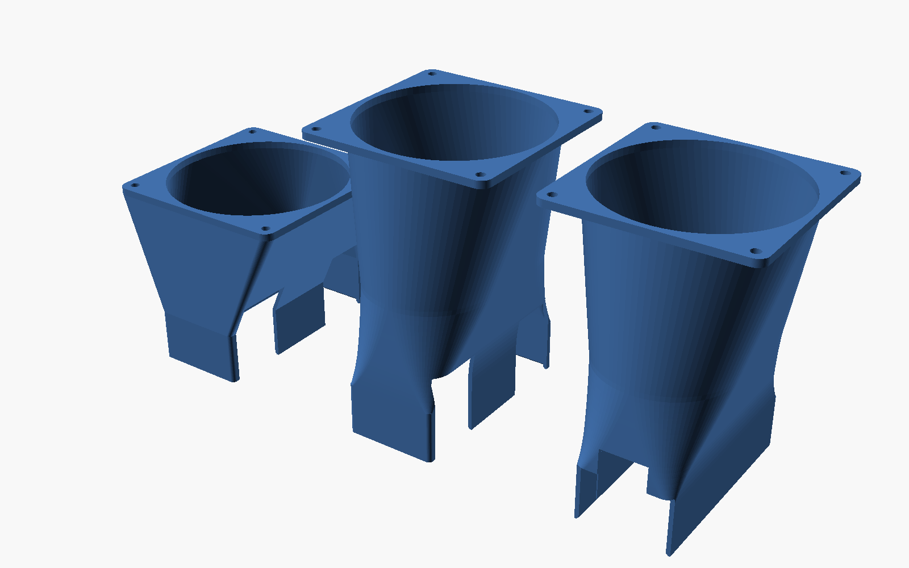

<!-- SPDX-License-Identifier: CC-BY-4.0 -->
# Fan shrouds for the VCA 2 — a working starting point, not a finished design

The VCA 2 is passively cooled. It was designed for a server chassis pushing a
lot of air through it, and in a normal desktop or tower it will cook itself
under sustained load — we measured **92–94 °C** on an all-node AVX2 workload
against Intel's 96 °C core limit, with nothing but ambient case airflow.

These shrouds are an attempt to fix that. **They are not finished.** Two
designs have been printed. A **120 mm v1** shroud with 2×120 mm fans has
cooled card 0 since it was fitted (by 2026-09-22), and that is the one
measured result: the
all-node AVX2 peak fell from 92–94 °C to **75–79 °C (−15 to −18 °C)**
([`../docs/THERMAL.md`](../docs/THERMAL.md#after-the-cooling-upgrade-2026-09-22)).
An 80 mm face-exit part was printed and test-fitted only. The other 80 mm and
92 mm variants, and 92 mm v2, have never been printed or measured. Treat
everything here as a base to modify, not a solution to print and trust.

Detailed sizes, print settings and every tunable parameter are in
[`REFERENCE.md`](REFERENCE.md). This file is about what is actually known.

## What has actually been verified

| | Status |
|---|---|
| Geometry is watertight | ✅ all 9 STLs checked in trimesh |
| Socket fit on the card | ✅ copied from a donor 40 mm mount that fits well |
| `vca2_80mm_shroud_faceexit.stl` prints and fits | ✅ printed, fitted on the I/O-bracket end |
| 120 mm v1 printed and in service | ✅ on card 0, fitted by 2026-09-22, 2×120 mm fans (which cable-exit variant was not recorded) |
| Thermal improvement, 120 mm v1 | ✅ **−15 to −18 °C** on the all-node AVX2 peak ([THERMAL.md](../docs/THERMAL.md#after-the-cooling-upgrade-2026-09-22)); card 0 logged 0 throttle events from 2026-09-21 to 09-29 ([THERMAL.md](../docs/THERMAL.md#software-mitigation-worth-considering)) |
| Every 80 mm and 92 mm STL | ❌ **never measured**; none printed except the 80 mm face-exit fit test |
| Cable slots line up with the real 12 V plugs | ❌ **never confirmed** |
| 92 mm v2 (bell loft): watertight, overhang ≤ 17.5° flange-down | ✅ checked in trimesh |
| 92 mm v2 printed, fitted, or measured | ❌ **never** |

The cable-slot row matters. The face-exit slot positions were derived from photos,
not from measuring the plugs. If they are off, the slots need re-cutting —
it is a one-line parameter change, but nobody has checked.

## Known problems

**1. The design target was wrong, and we only found out afterwards.**
These were sized and aerodynamically assessed against *GPU* load. The thermal
work in [`../docs/THERMAL.md`](../docs/THERMAL.md) later showed the binding
case is an **AVX2 CPU load** — 39 W concentrated in four cores runs ~20 °C
hotter than 35 W spread across the iGPU at the same package power. The GPU
case tops out at 76 °C; the CPU case hits 92–94 °C. Cooling should be
designed for the CPU case.

**2. They are symmetric, but the card is not.**
Nodes 1 and 2 ran **4–6 °C hotter than node 0** in every thermal phase. An
asymmetric shroud that biases flow toward that end would be better than these.

**3. Pull mode will separate.**
The rectangle-to-round transition is a **24–29° per-side diffuser** when used
as a puller. Flow separates above roughly 7°. Used as a *pusher* the same
geometry is a net contraction (area ratios 1.34 / 1.62 / 2.82 for 80/92/120),
which is stable and fine. **So: push, don't pull**, until the profile is
redesigned.

**4. The loft is too short to fill the hub wake.**
About **0.57 fan diameters** where roughly 1.0 is wanted. Every fan has a dead
zone behind its hub; you need about a diameter of duct for it to fill in.
Right in the middle of the card is a low-flow patch that shouldn't be there.

**5. The bracket variant is a guess, and deliberately a loose one.**
`bracket_clear` exists to clear the L-shaped support plate. Photogrammetry on
the end-on photo failed badly — scaling off the card width gave 10.18 px/mm,
off the card thickness gave 7.24 px/mm, a ~40 % disagreement caused by
perspective. Rather than trust a bad measurement, `bracket_w=0` removes the
**entire** edge wall. That always fits, but it gives up grip and sealing.
Measure your plate and set `bracket_w` properly.

**6. Crush ribs are untuned.**
`rib_h=0.5` gives 39.0 mm across a 38.69 mm card — about 0.3 mm interference.
That is a guess calibrated to one printer. Too tight, drop to 0.3; too loose,
raise to 0.7.

**7. Leakage probably matters more than the duct profile.**
The socket's dynamic head is only about **6.2 Pa**, against Intel's stated
requirement of **61–119 Pa** (0.246 in H₂O at 35 °C inlet, 0.476 at 45 °C).
So the duct geometry is roughly **5 % of the pressure budget**. Sealing the
cable slots and the bracket opening, and choosing a genuinely high-static-
pressure fan, will both do more than any amount of profile tuning. Ordinary
case fans top out near 0.1 in H₂O and are **not** sufficient.

**8. 2×80 mm was not enough for this card under sustained load.** Card 1
runs on 2×80 mm fans (whether in this repo's 80 mm shroud was not recorded).
Under the render farm one of its nodes logged 6,531 throttle events; another
logged ~1,890, throttled on every CPU, hit a DMA hang 34 s later on
2026-09-28 and has not come back; heat damage is the likeliest cause. Its nodes are now capped at 35 W, and at the
stock 45 W one still reaches 94 °C ([THERMAL.md](../docs/THERMAL.md#software-mitigation-worth-considering)).
Card 0 on 2×120 mm logged no throttle events over the same period. If you are
choosing a size, start from 120 mm; the 80 mm design is unmeasured.

## What I would fix first

1. **Measure the sizes that have not been measured.** Only 120 mm v1 has a
   number. Run [`../compute/burn.c`](../compute/burn.c) on all three nodes of
   a card and compare the peak core temperature against the 92–94 °C baseline
   in [`../docs/THERMAL.md`](../docs/THERMAL.md). `../compute/thermal_run.sh`
   is the harness. That single number decides whether a design works.
2. **Confirm the cable slots** against the real plugs before printing more.
3. **Measure the support plate** and set `bracket_w` instead of removing the
   whole wall.
4. **Then** redesign the profile: longer loft, curved bell instead of the
   straight taper, so pull mode stops stalling.

## 92 mm v2 — longer, smoother loft (2026-10-11)

`vca2_92mm_shroud_v2{,_faceexit,_bracket}.stl` address problems 3 and 4 above
for the 92 mm size only. The socket, ribs, cable slots and bracket cut are the
v1 geometry unchanged; only the transition is new.

| | v1 92 mm | v2 92 mm |
|---|---:|---:|
| Loft length | 55 mm (0.6 D) | **110 mm (1.2 D)** |
| Total length | 83.5 mm | **138.5 mm** |
| Equivalent-cone half-angle, peak | ~19° | **6.8°** |
| Wide-face wall angle, peak | ~24°, sharp corner at the socket | **13.3°**, eased in from 0° |
| Wall | ≥ 2.3 mm, uneven | 2.0 mm uniform |
| Volume | 94.6 cm³ | 78.6 cm³ |

What changed: a sliced loft (`loft="bell"`) instead of one hull. Width and
height grow linearly after a C1 ease-in over the first 15 %, so there is no
corner at the socket for flow to separate at. The corners round out on
`1-(1-t)^2` (clamped to half the width, so past mid-loft the section is a
stadium closing to the circle) rather than `√t`: that has the same airflow numbers, but `√t`
left a 67° ledge in the corners when printed flange-down.

What it does **not** fix:

- **Still push, not pull.** The 6.8° equivalent-cone angle is under the ~7°
  stall rule of thumb, but the two wide faces still diverge at up to 13.3°
  per side (40 → 88 mm while the height contracts). For a planar diffuser that
  is still past first stall. Pull mode should be much better than v1, but it
  is not shown to be attached.
- **Still symmetric** (problem 2), **still loose at the bracket** (problem 5),
  **cable slots still unconfirmed**. Leakage (problem 7) still dominates the
  pressure budget.
- **Height:** 138.5 mm printed upright. Check your printer's Z.

```bash
openscad -D fan=92 -D 'loft="bell"' -D loft_len=110 -D 'slot_side="face"' \
  -o vca2_92mm_shroud_v2_faceexit.stl vca2_fan_shroud.scad
```



## Files

Nine v1 STLs: three fan sizes × three cable-exit styles, plus the three 92 mm v2 variants above. All generated from
[`vca2_fan_shroud.scad`](vca2_fan_shroud.scad), which is the actual source —
the STLs are just exports.

| Suffix | Cable routing |
|---|---|
| *(none)* | Out through the card's top and bottom edges |
| `_faceexit` | Both cables out through one wide face |
| `_bracket` | Edge exit, plus one edge wall fully open for the support plate |

```bash
# regenerate any variant
openscad -D fan=92 -D 'slot_side="face"' -o out.stl vca2_fan_shroud.scad
```

Print flange-face down, no supports. v2 overhangs peak at 17.5° (measured on the mesh); v1 was not re-measured.

## A note on the donor models

The socket dimensions were reverse-engineered from a 40 mm fan mount that fits
this card well, and the fan flange pattern from an NVIDIA shroud. Neither is
included here — they belong to their authors. Only measurements were reused,
and the geometry is original.

The NVIDIA shroud could not be adapted directly: its socket is 86 mm against
the VCA 2's 96.3 mm card height. Its centre cutout is also unnecessary here,
because on this card both 12 V connectors sit at the two 96 mm edges with a
grille between them.
